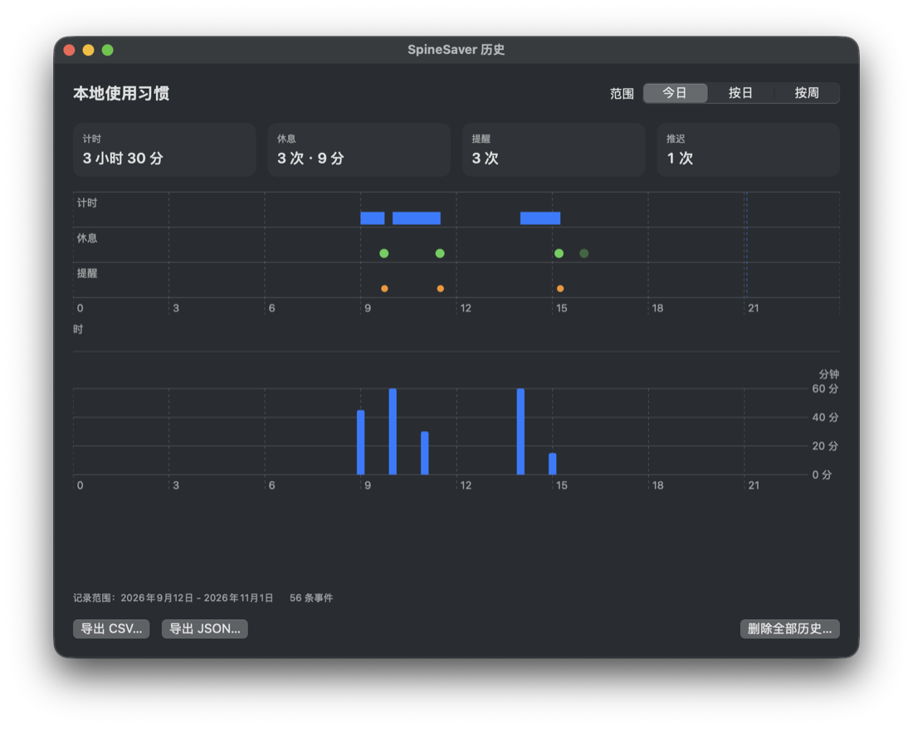
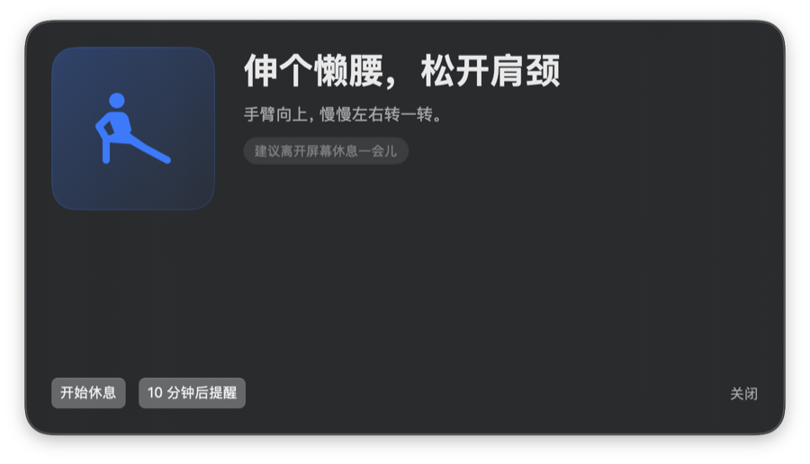

# SpineSaver

[中文](README.md) | **English**

A native macOS menu bar break reminder. It shows the current work cycle's
progress, counts down your break, and nudges you to stand up when the cycle
ends. It keeps a local usage log you can review and export. No account, no
sync, no network.

> **Note:** the app UI is currently Simplified Chinese only. This README is a
> translation for readers who want to understand or build the project.



## What it is

- Menu bar only, single process, entirely local. No accounts, no cloud sync, no
  network requests.
- 45 minute work cycle by default, adjustable from 15 to 120 minutes. Break
  length is adjustable from 2 to 15 minutes, default 2 minutes.
- When the cycle ends it shows one 696 x 380 pt mini panel that does not take
  input focus. You can start the break, snooze for the default 5 minutes, or
  pick Custom and enter 1 to 20 whole minutes for this reminder only (the app
  does not remember the value). Each reminder picks one of six scenes (walk,
  stretch, drink water, restroom, look into the distance, breathe slowly);
  consecutive reminders never repeat a scene, and the randomiser can be
  switched off in Settings.
- When the break countdown reaches 00:00 it ends automatically. If the screen is
  available it shows one "break finished" prompt with **Start next cycle** and
  **Later**. The next cycle never starts on its own.
- The menu bar shows `▶ Start` while waiting, `● NN%` while counting, and
  `☕ MM:SS` during a break, so the three states differ by shape and not only by
  colour.
- System sleep, display sleep, and user session switching freeze accumulation.
  Ten minutes of continuous absence restarts the screen timer.
- After the reminder appears and while a snooze is running, the app keeps
  recording observed work time (the cycle's percentage stays capped at 100%).
  Resting, manual pause, and waiting for a manual next-cycle start are not
  recorded.
- The percentage is a proxy for this cycle's screen-available time. It is not a
  fatigue score, a posture measurement, or a health rating.
- Local history records screen time slices, reminders, snoozes, and break
  actions. It can be viewed as today / by day / by week, exported as CSV or
  JSON, and deleted.

## Requirements

macOS 13 or later plus the Xcode Command Line Tools (Swift 6 toolchain). Without
an accepted Xcode licence you can build with the Command Line Tools alone; do
not change the global `xcode-select` path for this project.

```bash
swift run SpineSaverSelfTest   # deterministic self test, no XCTest needed
bash scripts/build-app.sh      # produces build/SpineSaver.app
open build/SpineSaver.app
```

`swift test` needs an accepted Xcode licence; on a machine without one it fails
with `unable to resolve module dependency: 'XCTest'`.

`scripts/build-app.sh` refuses to overwrite an existing `build/SpineSaver.app`.
For QA, build to a temporary path:
`SPINESAVER_APP_PATH="$TMP/SpineSaver.app" bash scripts/build-app.sh`. To
replace the real app, pass `SPINESAVER_ALLOW_REPLACE_APP=1`.

## Building a DMG (optional)

```bash
bash scripts/build-app.sh
bash scripts/build-dmg.sh
open build/SpineSaver.dmg
```

The DMG contains `SpineSaver.app` and an `Applications` shortcut. It uses the
system `hdiutil`; no third-party tooling is required.

**Important limitation:** the app inside the DMG is ad-hoc signed and not
notarised. The DMG does not bypass Gatekeeper: on another Mac the first launch
may still need right click then Open, or System Settings, Privacy & Security,
Open Anyway. Double-click installation would need an Apple Developer ID
certificate, hardened runtime, notarisation, and stapling. That is not done
here, and shipping an unnotarised build publicly is not recommended.

The current build is Apple Silicon (arm64). Intel Macs must build from source.

## Usage

Click the menu bar item to open the panel:

- **Counting:** accumulated and remaining time, with pause or start break now.
- **Due:** Start break, snooze 5 minutes (the default), or Custom for 1 to 20
  whole minutes applying to this reminder only. The menu bar panel offers the
  same three actions; the system notification channel offers only Start break
  and the default 5-minute snooze, so use the mini panel or the menu bar for a
  custom duration.
- **Resting:** remaining countdown; ends automatically at 00:00, and can be
  finished early or cancelled.
- **Break finished, waiting to start:** one prompt appears when the screen is
  available, and the menu bar shows `▶ Start`. Start next cycle resumes
  counting; Later only closes the prompt. The prompt appears once per finished
  break and never re-appears after being closed.
- **Paused:** resuming restores the previous progress; resuming after the cycle
  deadline reminds you once more.

Settings cover the work cycle, break length, reminder channel (mini panel or
system notification), the random scene toggle, and launch at login. The history
window shows the three views, exports, and deletion.



## History and export

- Recorded events: screen time slices, reminder presented, snoozed, break
  started, break finished / finished early / cancelled / auto-completed, app
  quit.
- Three views: **Today** (a 24 hour strip with work, rest, and reminder lanes,
  four summary tiles with units, and an hourly work chart), **By day** (last 14
  days), **By week** (last 8 ISO weeks).
- Every chart axis tick carries its unit ("min" or "count"), and each trend
  chart has a detail list underneath. Empty days render as zero instead of
  disappearing.
- CSV and JSON exports include version, export time, time zone, units, field
  descriptions, and definitions. You choose where to save them; nothing is
  uploaded. After you confirm the save dialog, the app re-reads the history
  once before writing the export.
- If the statistics look stale, first copy the raw
  `~/Library/Application Support/SpineSaver/history.jsonl`, then export a fresh
  JSON from the history window and compare event by event. The window and the
  export share one latest-good snapshot, so an export alone is not evidence of
  what reached disk; write failures show a warning in Settings and the history
  window.
- Deleting history requires a second confirmation. Resetting settings does not
  delete history.
- Records describe in-app timers and actions only. They cannot prove that you
  stood up or actually rested. No health, water, or restroom data is stored.

## Privacy

No network access, no keyboard content, no Accessibility or Input Monitoring
permission, no water or restroom records. Settings, current progress, and the
local usage log stay on this Mac. You can review the range, export CSV or JSON,
and delete it. The chosen reminder scene is stored locally as a single
identifier, only to avoid repeating the previous scene.

See [docs/PRIVACY.md](docs/PRIVACY.md) for data locations.

## Known limitations

- Locked screen with the display still on has no confirmed public signal. That
  interval may keep counting. The app does not use undocumented APIs to improve
  this.
- If you leave while the display stays on, accumulated time may be too high.
- The self-drawn panel is not managed by Focus, so it can appear during a Focus
  session. Choose the system notification channel if that matters.
- System notifications depend on authorisation and Focus; the app does not fall
  back to the mini panel when a notification is hidden.
- Relaunching while waiting after a break restores a plain pause, without
  re-showing the completion prompt.
- After the follow-up reminder you can snooze again; the current
  implementation does not cap snoozes per cycle (whether to tighten this is
  pending a product decision).
- The `appVersion` in exports and history is self-reported and cannot identify
  a specific build; check Finder's Get Info when diagnosing.
- Launch at login is managed by `SMAppService` and may require approval.

## QA switches

Environment variables used only for acceptance runs:

```bash
SPINESAVER_QA_SUITE=com.desmond.spinesaver.qa \
SPINESAVER_QA_RESET=1 \
SPINESAVER_QA_START_COUNTING=1 \
SPINESAVER_QA_INTERVAL_SECONDS=6 \
SPINESAVER_QA_REST_SECONDS=2 \
SPINESAVER_QA_HISTORY_PATH="$TMP/history.jsonl" \
./build/SpineSaver.app/Contents/MacOS/SpineSaver
```

The QA suite uses a separate `UserDefaults` domain, so daily settings are not
touched. Additional keys: `SPINESAVER_QA_OFFSCREEN_SECONDS`,
`SPINESAVER_QA_REMINDER_SCENE` (`walk`, `stretch`, `hydrate`, `restroom`,
`farLook`, `breathe`), and the visual entry points
`SPINESAVER_QA_OPEN_SETTINGS`, `SPINESAVER_QA_OPEN_HISTORY`,
`SPINESAVER_QA_SHOW_REMINDER`, `SPINESAVER_QA_HISTORY_RANGE`.

## Layout

- `Sources/SpineSaverCore/`: clock abstraction, pure state machine, menu bar
  text, settings validation, history, aggregation, export, duration text,
  intraday timeline, reminder scenes. Shared by the self test and XCTest.
- `Sources/SpineSaver/`: SwiftUI menu bar and panels, AppKit reminder window,
  history window, system and notification adapters.
- `Sources/SpineSaverSelfTest/`: deterministic acceptance program without XCTest.
- `Tests/SpineSaverTests/`: XCTest mirror, for machines with an Xcode licence.
- `Resources/Info.plist`: `LSUIElement=true` and bundle metadata.
- `scripts/build-app.sh`: assembles and ad-hoc signs the local app.

## License

MIT, see [LICENSE](LICENSE). Third-party and asset notes are in
[docs/THIRD_PARTY.md](docs/THIRD_PARTY.md).
