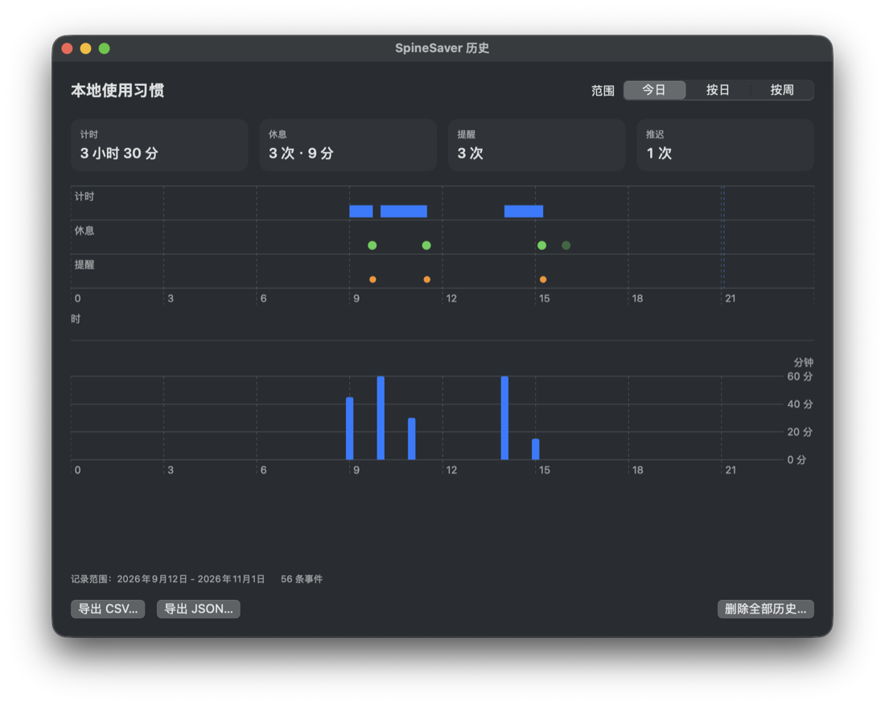

# SpineSaver

**中文** | [English](README.en.md)



一个原生 macOS 菜单栏休息提醒器：显示本轮工作进度，休息时显示倒计时；到点提醒你起身走一走，也可以顺便喝水、按需去洗手间；本地记录使用习惯，可查看和导出。

> **首次使用**：如果你的菜单栏使用 Bartender、Ice 等管理器，新的菜单栏项可能默认被收进隐藏区。请在管理器中把 **SpineSaver** 设为可见，否则打开应用后看不到百分比。

## 它是什么

- 仅驻菜单栏、单进程、纯本地；没有账号、云同步或网络请求。
- 默认 45 分钟一轮，可调 15–120 分钟；休息时长可调 2–15 分钟，默认 2 分钟。
- 到点弹出一次不抢输入焦点的较大迷你窗（约 696 × 380 pt）；可“开始休息”、“5 分钟后提醒”，或“自定义…”输入 1–20 整分钟（仅对本次推迟生效，应用不记住）。提醒会从 6 个场景里随机取一个（起身走动、伸个懒腰、接杯水、去洗手间、看看远处、慢呼吸），相邻两次不重复，可在设置里关掉随机。
- 休息倒计时到 00:00 自动结束，屏幕可用时主动弹出一次“休息倒计时已结束”提示，提供“开始新一轮 / 稍后开始”；选择系统通知渠道时由系统通知提供这个入口。新一轮始终由你手动开始，应用不会自动开始计时，也不根据键鼠静默或倒计时宣称你已起身。
- 等待开始时菜单栏显示 `▶ 开始`，与工作 `● NN%`、休息 `☕ MM:SS` 一眼可分。
- 系统睡眠、屏幕熄灭、用户会话切开会冻结累计；连续离屏 10 分钟会重新开始屏幕计时。
- 到点提醒弹出后与推迟期间仍按“可观测工作”继续记录屏幕时长（本轮进度封顶 100% 不再增长）；休息中、手动暂停和休息结束等待手动开始不记录。
- 百分比是本轮“屏幕可用时间”的代理指标，不是疲劳值、坐姿或健康评分。
- 本地记录屏幕计时、提醒、推迟和休息操作；可按今日/按日/按周查看、导出 CSV/JSON、主动删除。

## 构建与运行

需要 macOS 13+ 和 Xcode Command Line Tools（Swift 6 工具链）。没有 Xcode 许可时可直接用 Command Line Tools 构建；不要为此修改全局 `xcode-select`。

```bash
swift run SpineSaverSelfTest   # 确定性自测，不需要 XCTest，项数随功能扩充
bash scripts/build-app.sh      # 产出 build/SpineSaver.app
open build/SpineSaver.app
```

如果以后同意 Xcode 许可，可运行 `swift test` 使用 `Tests/SpineSaverTests/BreakCycleTests.swift`。

`scripts/build-app.sh` 默认拒绝覆盖已存在的 `build/SpineSaver.app`；QA 构建到临时路径：`SPINESAVER_APP_PATH="$TMP/SpineSaver.app" bash scripts/build-app.sh`；确需替换真实 app 时显式 `SPINESAVER_ALLOW_REPLACE_APP=1`。

## 打包 DMG（可选）

```bash
bash scripts/build-app.sh
bash scripts/build-dmg.sh
open build/SpineSaver.dmg
```

DMG 里包含 `SpineSaver.app` 和 `Applications` 快捷方式，打开后把 app 拖进 `Applications` 即可。`scripts/build-dmg.sh` 使用系统自带 `hdiutil`，不需要第三方工具；可用 `SPINESAVER_APP_PATH` / `SPINESAVER_DMG_PATH` 指定其他 app/DMG 路径。

**重要限制**：当前 DMG 里的 app 是 ad-hoc 签名、未公证。DMG 只是包装，不会绕过 Gatekeeper；在其他 Mac 上首次打开仍可能需要右键 app → 打开，或到“系统设置 → 隐私与安全性 → 仍要打开”。若要让别人双击即装，需要 Apple Developer ID 证书、hardened runtime、notarization 和 stapling；当前项目没有做，也不建议直接公开分发未公证的构建。

当前本机构建是 Apple Silicon（arm64）；Intel Mac 不能运行这个 DMG 里的 app，需要在 Intel Mac 上从源码构建。

## 使用

启动后菜单栏显示工作进度；休息时显示倒计时。点击它打开面板：

- **计时中**：显示累计/剩余时间；可暂停或立即休息。
- **该休息了**：显示“开始休息”“5 分钟后提醒”“自定义…”（输入 1–20 整分钟，仅本次生效）。菜单栏面板提供同样的三个入口；系统通知渠道只有“开始休息”和“5 分钟后提醒”两个操作，自定义推迟请用迷你弹窗或菜单栏。
- **休息中**：显示剩余倒计时；到 00:00 自动结束，可提前结束或取消。
- **休息结束待开始**：屏幕可用时弹出一次“休息倒计时已结束”提示，菜单栏显示 `▶ 开始`。点“开始新一轮”恢复工作计时；点“稍后开始”只关闭提示，之后可随时从菜单栏开始新一轮。提示每次完成只弹一次：关闭后不再重弹；离屏时已打开的提示会随之隐藏，回屏后显示的是同一个提示而不是新弹一次；修改设置也不会触发新提示。
- **已暂停**：继续后恢复原进度；到点后继续会再提醒一次。

设置里可以改工作周期、休息时长（2–15 分钟）、选择迷你弹窗或系统通知、开关“随机提醒画面”、开启登录启动；也可以打开历史窗口查看今日/按日/按周图表、导出 CSV/JSON、删除历史。系统通知需要 macOS 授权；未授权时请切回迷你弹窗，且无论哪种方式，等待开始时菜单栏的 `▶ 开始` 始终是可用的手动入口。系统通知可能被专注模式（Focus）隐藏或未授权而看不到，这不影响菜单栏入口，应用也不会因此改弹自绘窗口。

## 本地记录与导出

- 记录应用可观测的事件：屏幕计时增量、提醒发出、推迟、开始休息、休息完成/提前结束/取消/自动完成、应用退出。
- 三个视图：**今日**（24 小时时间轴，分计时/休息/提醒三条泳道，加四块带单位汇总卡与按小时计时柱）、**按日**（最近 14 天）、**按周**（最近 8 个自然周）。
- 每张趋势图的 Y 轴刻度都带单位（“分”或“次”），图表下方有逐条明细列表；空日显示 0，不会消失。
- 导出 CSV 或 JSON：包含版本、导出时间与时区、单位、字段说明和口径；文件由你选择保存位置，不上传、不自动发送。导出确认后会重新读取一次历史，再生成文件。
- 怀疑统计没更新时：先复制原始文件 `~/Library/Application Support/SpineSaver/history.jsonl`，再从统计窗口导出一份新的 JSON，按事件对照。统计窗口与导出使用同一份最近成功读取的快照，导出内容本身不能证明记录是否落盘；写入失败时设置和统计窗口会显示保存警告。
- 删除历史需要二次确认；重置设置不会删除历史。
- 记录只说明应用内计时/操作，不能证明你已起身或实际休息；不保存健康、喝水或如厕记录。

## Bartender / 菜单栏管理器

如果你的菜单栏使用 Bartender、Ice 等管理器，新出现的小应用默认可能被收进隐藏区。请在管理器中把 **SpineSaver** 设为可见，否则你看不到百分比和 `▶ 开始` 入口。这是菜单栏管理器的行为，不是应用没有启动。

## 后续路线图

- TTS 语音提醒：未来只研究 macOS 本地系统语音，默认关闭，用户可控制开关/语音/音量；评估静音、耳机、隐私、语言、与通知/Focus 的关系。本轮不实现、不联网、不接外部 TTS。

## 已知限制

- 锁屏但屏幕仍亮、且用户会话没有切换时，公开 API 没有已证实的完整锁屏信号；这段时间可能继续计入。应用不会为了“更准确”而使用未文档化 API。
- 人离开但屏幕保持亮着时，累计时间可能偏高。百分比不声称反映真实坐姿或身体活动；任何提示都不代表你已起身或实际休息。
- 自绘迷你弹窗和恢复提示不受系统专注模式（Focus）自动管理，可能在专注时出现；希望严格遵循 Focus 时请选择系统通知或手动暂停。
- 系统通知是否显示受通知权限与 Focus 设置影响；未授权或被隐藏时应用不保证提示被看到，也不改用自绘窗替代。休息结束等待开始时，菜单栏 `▶ 开始` 仍可用。通知动作（含恢复动作）带会话/周期令牌，旧通知不会改变新周期。
- 休息结束等待期间重启应用，恢复为普通暂停（0%、无提示），不会补弹完成提示，也不会重复记录自动完成。
- 复提醒到点后仍可以再次推迟；当前实现不限制一轮内的推迟次数，是否收紧待产品裁决。
- 导出与历史里的 `appVersion` 是应用自报版本，不能区分具体构建；排查问题时以 Finder“显示简介”里的版本为准。
- 登录启动由 `SMAppService` 管理，若系统要求批准，设置里会显示提示。
- 历史记录只反映应用内计时和操作，不能证明真实休息；导出文件由你主动保存，应用不会自动发送。

## QA 启动开关

以下环境变量只用于验收，正常使用不需要：

```bash
SPINESAVER_QA_SUITE=com.desmond.spinesaver.qa \
SPINESAVER_QA_RESET=1 \
SPINESAVER_QA_START_COUNTING=1 \
SPINESAVER_QA_INTERVAL_SECONDS=6 \
SPINESAVER_QA_REST_SECONDS=2 \
SPINESAVER_QA_HISTORY_PATH="$TMP/history.jsonl" \
./build/SpineSaver.app/Contents/MacOS/SpineSaver
```

QA 套件使用独立的 `UserDefaults` 域，不会污染日常设置；`SPINESAVER_QA_HISTORY_PATH` 把历史写到临时文件，不会污染真实历史。可用键：`SPINESAVER_QA_INTERVAL_SECONDS`、`SPINESAVER_QA_SNOOZE_SECONDS`、`SPINESAVER_QA_OFFSCREEN_SECONDS`、`SPINESAVER_QA_REST_SECONDS`、`SPINESAVER_QA_START_COUNTING`、`SPINESAVER_QA_RESET`、`SPINESAVER_QA_SUITE`、`SPINESAVER_QA_HISTORY_PATH`、`SPINESAVER_QA_REMINDER_SCENE`（取值 `walk`/`stretch`/`hydrate`/`restroom`/`farLook`/`breathe`，只影响 QA 提醒窗）；QA-only 视觉入口：`SPINESAVER_QA_OPEN_SETTINGS`、`SPINESAVER_QA_OPEN_HISTORY`、`SPINESAVER_QA_SHOW_REMINDER`（正常启动忽略）。

## 结构

- `Sources/SpineSaverCore/`：时钟抽象、纯状态机、菜单栏文案、设置校验、历史/聚合/导出逻辑，可由自测和 XCTest 共用。
- `Sources/SpineSaver/`：SwiftUI 菜单栏/面板、AppKit 提醒窗、历史窗口、系统事件与通知适配。
- `Sources/SpineSaverSelfTest/`：不依赖 XCTest 的确定性验收程序。
- `Tests/SpineSaverTests/`：XCTest 版本，供有 Xcode 许可时使用。
- `Resources/Info.plist`：`LSUIElement=true` 与 bundle 元数据。
- `scripts/build-app.sh`：组装并 ad-hoc 签名本地 .app。

## 隐私

不联网、不读取键盘内容、不申请辅助功能或输入监控权限、不保存喝水/如厕记录。只在本机保存设置、本轮进度和本地使用习惯记录；可查看范围、导出 CSV/JSON、主动删除；记录不能证明真实休息。提醒场景只在本机存一个场景标识（用来避免连续重复），不记录你实际做了什么。

## 许可证

本项目以 MIT 许可证发布，见 [LICENSE](LICENSE)。第三方组件与素材说明见 [docs/THIRD_PARTY.md](docs/THIRD_PARTY.md)，本机数据处理说明见 [docs/PRIVACY.md](docs/PRIVACY.md)。
